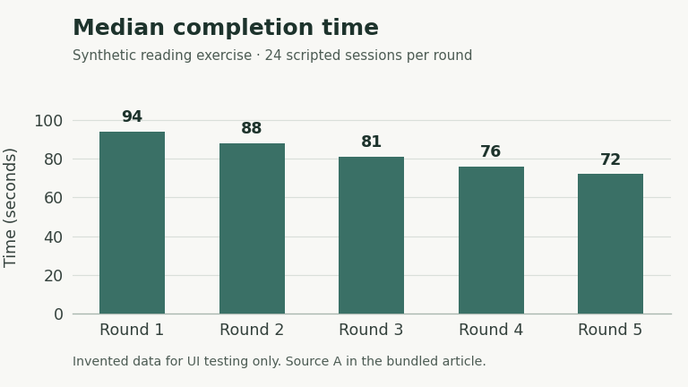

# Cedar Reading Room: a synthetic article for careful reading

**Fixture status:** Every person, place, session, observation and number in this article is invented. This is source material for an isolated BRN test workspace. It is not a real study, evidence of native implementation, or a record of an import having succeeded. The two sources at the end are synthetic sections of this same file. No external service is required.

The fictional Cedar Reading Room stores short repair notes for an imaginary collection of paper maps. Readers need to find an instruction, inspect its supporting evidence and return to the same paragraph without losing their place. This article provides enough ordinary prose to test that experience across several screens. It also contains deliberate structural variations: repeated headings, a skipped heading level, code, lists, two tables and one local figure.

> A readable page should help the reader check a claim without losing the paragraph that gave it meaning.

## The question

A quiet reading surface should help a person understand a document before choosing an action. Cedar's invented exercise asks whether readers can locate a maintenance instruction and check its source without treating a polished page as a guarantee of accuracy. The exercise describes five synthetic rounds. Each round represents twenty-four scripted sessions, rather than observations of real people. The values were chosen to make comparisons easy to inspect. [Source A](#source-a) defines the data.

The question is narrower than whether one interface is universally better. A shorter completion time might indicate clearer navigation, but it could also mean that a reader skipped evidence. The fictional team therefore keeps completion and verification separate. This distinction creates useful reading tasks without pretending that an example chart establishes a product claim.

### Review

The first review asks a reader to explain the difference between opening an article and checking the instruction inside it. Finding the right title is only the beginning. In Cedar's scenario, the original instruction remains visible until a checked change replaces it.

#### Evidence boundary

The invented reviewers use the source ledger to distinguish supplied values from interpretation. They do not invent missing measurements. If a source cannot be opened during a controlled test, the reader should see that limitation and retain the article. A temporary rendering fault must not turn the source into a new destination or silently remove the citation. [Source B](#source-b) describes the synthetic procedure and its limits.

## Walking through one session

The fictional reader begins at the article title, opens an outline and jumps to the table of round results. Next, they open the supporting source, check the meaning of verification and return to the table. Finally, they read the conclusion and explain one reason the apparent improvement might be misleading. The task is intentionally ordinary. Long paragraphs, rather than a grid of promotional cards, carry the explanation.

The following sequence is a script for this imaginary exercise:

1. Find the result for Round 3 and read its unit.
2. Compare the count of completed tasks with the count of verified tasks.
3. Open the source cited beside the result.
4. Return to the same reading position and continue to the interpretation.

The script does not specify a model, provider or external account. It does not authorize changes to saved knowledge. A reader who wants to ask a question can do so without applying a proposed rewrite.

### A deliberately long heading about preserving the reader's place while supporting material opens, closes and changes shape in a compact window

This heading is long enough to wrap in a narrow outline. Its position in the document must not depend on a truncated visual string. After a reader opens and closes a supporting panel, the paragraph they were reading should remain available without an unexplained jump to the beginning.

### Märkmed ja ülevaade — Õ, ä, ö, ü and 東京

This heading tests Unicode text as ordinary document content. Its characters are intentional. Search, selection and the outline should preserve them exactly, including the long dash. Displayed text and stored text should agree.

## Results from the invented rounds

The normal table gives the complete numerical series used by the figure. “Completed” means the scripted session reached the final instruction. “Verified” means it also reached the synthetic evidence section. Median time is supplied test data, measured in seconds within the fictional scenario; it was not calculated from real observations. [Source A](#source-a) is the local source for every cell.

| Round | Completed / 24 | Verified / 24 | Median time (s) |
|---|---:|---:|---:|
| 1 | 15 | 11 | 94 |
| 2 | 17 | 13 | 88 |
| 3 | 19 | 16 | 81 |
| 4 | 20 | 18 | 76 |
| 5 | 21 | 19 | 72 |



*Figure 1. Invented median completion times for five scripted rounds, matching the table above. Lower is faster within this example only. Synthetic data: [Source A](#source-a).*

The chart should remain legible as an image inside a readable article. It has its own light background so that labels remain clear in both application themes. Its alternative text contains the values and the zero baseline.

### Review

This second “Review” belongs to the results section, while the first belongs to the question section. The identical labels are intentional. An outline should offer two distinct destinations and use their structural context. Renaming the first heading in a draft must not rename or move the second. Removing a heading should not send a stale outline entry to a different section with the same text.

The difference between the first and fifth median values is twenty-two seconds. That arithmetic is valid for the synthetic series, but it does not explain the cause. The verification counts also increase. Neither pattern proves that a particular component, spacing value or navigation choice caused the change, because the fixture contains no experimental control or real participant records.

## A deliberately skipped heading level

#### Detail without an intermediate subheading

This H4 follows an H2 without an H3. The skip is deliberate and must remain visible in the source. A renderer may indent the outline sensibly, but it should not create a new heading that was never written. This section also tests the difference between document structure and a code sample that happens to use heading characters.

```markdown
# This is a code example, not an article heading
## Do not add this line to the document outline
instruction: preserve the original text
```

The fence is part of the fixture. Copying or editing its contents should not unexpectedly alter the article outline. The following wide table supplies a separate horizontal overflow case; surrounding prose should continue to fit the reading column.

| Round | Scripted sessions | Completed tasks | Verified tasks | Median seconds | Outline opening | Source opening | Return marker | Sample context | Dataset status |
|---|---:|---:|---:|---:|---|---|---|---|---|
| 1 | 24 | 15 | 11 | 94 | Explicit action | Local section | Results table | Cedar exercise | Synthetic only |
| 3 | 24 | 19 | 16 | 81 | Explicit action | Local section | Results table | Cedar exercise | Synthetic only |
| 5 | 24 | 21 | 19 | 72 | Explicit action | Local section | Results table | Cedar exercise | Synthetic only |

## Interpretation and next questions

The imaginary team records three useful distinctions:

- A completed task and a verified task are different outcomes.
- A source link and a source's contents are different pieces of information.
- A saved article and a proposed revision are different states of the same work.

A calm page can make these distinctions easier to notice, but the page must still tell the truth. If saving fails, the reader's draft needs a clear recovery route. If a proposal is applied, its receipt should remain available even if a later cleanup operation fails. If an old revision is displayed, its headings should describe that revision. These are scenario requirements, not claims that any native screen has passed them.

Its purpose is to expose navigation, rendering and state mistakes using reproducible source material. It should stay useful even when the interface layout changes, because its content does not depend on a live website, a remote image or a particular model response.

## Source A

**Synthetic data ledger.** The author supplied five records: medians of 94, 88, 81, 76 and 72 seconds; completed counts of 15, 17, 19, 20 and 21; verified counts of 11, 13, 16, 18 and 19. Every round has twenty-four scripted sessions. The article table and bundled PNG reproduce these exact values. No raw observations exist, and no real measurement is implied.

## Source B

**Synthetic procedure note.** The author invented the Cedar scenario and the four-step reading script solely for interface validation. Completion means reaching the final instruction; verification additionally means reaching Source A. Causal explanations, confidence intervals and recommendations are deliberately absent. These definitions provide local citation targets; they do not represent imported external evidence or approval to alter protected content.
