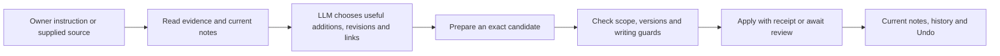

# Ordinary notes and an LLM wiki for BRN

**Research date:** 13 October 2026. **Inspected baseline:** `65119a73a6aaea13764b8bc6290f7bb6dc79ff2d`, matching fetched `origin/main`. **Assignment:** explain current ordinary-note generation and evaluate an LLM wiki approach. This is a research recommendation, not an accepted contract amendment or implementation assignment. No runtime behavior or owner data was changed.

“Capati” is interpreted as **Andrej Karpathy**. His LLM Wiki is one formulation of the broader LLM-maintained wiki pattern, rather than a competing concept.

## Recommendation

Adopt a maintained, source-grounded wiki as the organizing policy for BRN's ordinary **knowledge** notes. Keep the existing checked service, SQLite state, note protection, review, revisions, and Undo. Keep ordinary writing and drafts possible too: permission to edit and a page's purpose are separate questions.

The practical change is to define what deserves a persistent page, how it connects to other pages, what supports its claims, and when evidence changes require a refresh. BRN already delegates these decisions to an LLM, but its current guidance is broad. A wiki policy would give that delegation a more specific purpose and quality bar.

Start with guidance and evaluated examples. Add deterministic checks where they can actually establish something: valid references, recorded evidence versions, broken links, version conflicts, and available source coverage. Do not require a new database, a graph database, a Markdown authority layer, or a note for every source.

## What “normal nodes” mean today

The current product calls them **ordinary notes**. There is one `Note` record with `title`, `markdown`, `protected`, `confirmed`, `superseded_by`, and optional import coverage. `Note::working` creates an unprotected, unconfirmed note. The app's human `new_note` operation uses that constructor too. Ordinary is therefore an editing policy, not an AI-authorship classification. There is no current entity/concept/synthesis enum or special normal-node generator. [Note model](../../crates/brn-threads-core/src/types.rs), [human creation](../../crates/brn-threads-app/src/lib.rs).

| Property | What it establishes |
|---|---|
| Ordinary / unprotected | Eligible for AI maintenance when the owner has granted the applicable scope. |
| Protected | Editing or structurally displacing this note needs the appropriate owner authority. |
| Confirmed | Records an explicit owner confirmation at a revision; does not follow an AI rewrite automatically. |
| Imported reference | Contains supplied source content and recorded conversion coverage. A full import begins protected and unconfirmed. |
| AI-authored | Describes authorship/history; it does not itself establish permission, truth, or source completeness. |

Protected notes may be source references, owner decisions, or writing whose wording matters. They are not necessarily immutable original documents, and protection does not certify truth. An ordinary note may contain human writing. [Canonical protection contract](../architecture/threads-target.md#ordinary-notes-and-protected-notes), [invariants](../architecture/invariants.md).

The reason ordinary notes exist is the central product promise: incoming information should improve useful working knowledge without requiring the owner to file and approve every routine edit. Ordinary notes hold reusable project context, explanations, summaries, plans, and synthesis. Protected notes preserve consequential decisions, reference content, and selected wording. Current ordinary knowledge can include content the owner has never individually reviewed. History and Undo support recovery; they do not prove factual accuracy. [Selected direction](../architecture/threads-target.md#selected-direction), [current knowledge](../architecture/threads-target.md#current-does-not-mean-personally-reviewed).

## How they are generated and updated

### Triggers and context

An owner question/delegation or a useful-information import starts a provider run. Continue starts a fresh invocation from saved conversation, current records, and receipts. The desktop's useful intake converts a supplied file, creates a thread, and sends the converted text, source fingerprint, coverage, and available assets to the runtime. Its instruction asks for useful supported information, maintenance of related ordinary notes, and preservation of qualifications. A full-note import takes a separate faithful-conversion path and creates a protected reference. [Desktop intake and dispatch](../../crates/brn-desktop/src/threads_ui.rs), [full import](../../crates/brn-threads-app/src/intake.rs), [runtime preparation](../../crates/brn-ai/src/threads.rs).

The inspected entry points do not establish a continuously running wiki compiler, a periodic semantic lint process, or an external-source watcher. Choosing maintenance is permission to apply ordinary changes during applicable work, not proof that BRN continuously monitors the owner's files or email. Source re-reading through connectors remains a later capability where unavailable. [Dependency refresh contract](../architecture/threads-target.md#when-other-work-depends-on-it), [current runtime](../../crates/brn-ai/src/threads.rs).

### The semantic decisions

The selected LLM receives the packaged base guide and a small playbook catalog. It can load `intake` and `maintain-notes` using `read_skill`. These are shipped runtime instructions, distinct from this repository's development `AGENTS.md`. [Guidance bundle](../../crates/brn-ai/src/threads_guides.rs).

The guidance tells it to:

1. Read the supplied evidence and find current related notes, sources, threads, and Actions.
2. Preserve relevant facts, dates, quantities, units, qualifications, requests, and dependencies.
3. Decide whether to revise an existing note, create useful new knowledge, add thread context, or suggest an Action. One source need not produce one note.
4. Keep reported source claims separate from owner decisions. Preserve unresolved conflicts and protected content.
5. Prepare the smallest coherent change group, record direct input versions and source relationships, then inspect the real application outcome.

These are semantic judgments made by the model, with variation possible across runs and models. The software does not deterministically extract every sentence into a node or require a particular page outline. [Intake playbook](../../agent/skills/intake/SKILL.md), [maintenance playbook](../../agent/skills/maintain-notes/SKILL.md), [base guide](../../agent/BRN.md).

### The checked write

The LLM supplies complete proposed note content and typed changes through `prepare_changes`. The host fixes durable operation identities and materializes selected source evidence/assets. `apply_changes` passes through the shared checked boundary. SQLite checks current versions, authority, protection, and persisted human editing guards, then commits the related changes and a receipt together. A stale or guarded member prevents the whole dependent group from being applied. [Runtime tools](../../crates/brn-ai/src/threads.rs), [source binding](../../crates/brn-ai/src/threads_sources.rs), [checked writer](../../crates/brn-threads-core/src/store.rs).

Ordinary AI application requires explicitly chosen and enabled maintenance or applicable host-bound authority. In review-first or unchosen settings, standing maintenance does not authorize application; candidates can await review. Protected edits require their specific scope. Rewrites from the writing workbench are proposals for exact review even when ordinary maintenance is enabled. [Delegation implementation](../../crates/brn-threads-core/src/store.rs), [behavior contract](../architecture/threads-behavior.md#implemented-response-and-authority-contract).

### A concrete example

Suppose two emails concern Project Harbor. One says delivery is **estimated** for 15 November; another confirms a meeting for 10 November. BRN should find the existing project note, retain the estimate as an estimate with its source, update the meeting detail, and link useful context. It should not create two disconnected email summaries by default.

If a protected owner decision says the delivery commitment is 22 November, the estimate is evidence of a discrepancy, not authority to replace that decision. The project note can describe both positions and the thread can ask for the consequential choice. This example illustrates the selected behavior; it is not a fresh provider test. [Maintenance example](../../agent/skills/maintain-notes/SKILL.md), [conflict journey](../architecture/threads-behavior.md#email-to-a-supported-reply).

## What is missing from the current logic

The persistence and authority machinery is concrete. The organizing policy is less concrete:

- No explicit admission rule for a durable page: reusable concept versus temporary answer, independent entity versus passing mention, existing page update versus a duplicate.
- No agreed page outlines for a person/project, concept, or synthesis, or rule for when to split/merge ordinary notes.
- No general requirement that every important factual passage carry a source locator and relevant date. Source records and declared inputs exist, but a valid reference does not prove that the source entails the claim.
- No measured end-to-end wiki quality gate for coverage, factual support, duplicate growth, or contradictory incoming evidence.
- Direct dependency flags identify records that may need refresh after an input changes. They do not discover every semantic or indirect dependency and do not automatically repair content. The owner can open a follow-up from the receipt. [Refresh implementation](../../crates/brn-threads-app/src/refresh.rs), [direct dependency implementation](../../crates/brn-threads-core/src/store.rs).

Retrieval also needs an honest distinction. The native app uses a current-note keyword index with up to 30 results. The registered agent's `read_records(query)` presently performs a case-insensitive literal substring match across complete titles and Markdown and returns at most 100 records; it does not use that ranked index. Long saved notes support bounded versioned passage reads. An unfiltered record read is not a complete catalog once the cap is reached. A good wiki policy must be matched by tools that let the agent reliably discover related pages at the intended scale. [App search](../../crates/brn-threads-app/src/lib.rs), [agent reads](../../crates/brn-ai/src/threads.rs), [note reads](../../crates/brn-threads-core/src/read.rs).

## What Karpathy's concept contributes

Karpathy's [original idea file](https://gist.github.com/karpathy/442a6bf555914893e9891c11519de94f), created 4 April 2026, describes persistent linked pages built from curated sources, governed by a schema document. Its main workflows are ingestion, querying with citations, and periodic maintenance. Source, entity, concept, and synthesis pages accumulate useful interpretation across sessions. Valuable answers can become durable pages. An index supports navigation and a chronological log records work. The file presents a modular pattern rather than a library or benchmarked product.

For BRN, the useful addition is an explicit compilation policy. The storage medium and specific file names are incidental to that policy. A source-grounded wiki can live in BRN's existing notes and links, with receipts providing its change log and search/catalog views supporting navigation.

## What the external evidence supports

Wiki compilation, retrieval, and agent memory are related mechanisms, not interchangeable product guarantees.

| Approach | Where it adds value | Implication for BRN |
|---|---|---|
| Source retrieval / RAG | Finds underlying passages when a question needs details or evidence. | Keep it available for checking synthesis and answering details compilation omitted. |
| Maintained wiki | Stores reusable explanations, relationships, and synthesis across inputs. | Use it to organize ordinary knowledge; measure information retained and update behavior. |
| GraphRAG | Precomputes entity/relationship structure and community summaries for retrieval. | Demonstrates that compiled structure and retrieval can coexist; a graph database is not needed to start a BRN wiki policy. |
| Conversational agent memory | Recalls events, preferences, and facts across sessions. | Useful adjacent evaluation ideas, but memory benchmark scores do not validate a wiki of external research sources or its editing guarantees. |

Microsoft's [GraphRAG documentation](https://microsoft.github.io/graphrag/) describes extraction and community summaries as structures used during retrieval, with different query modes including basic retrieval. That directly challenges an overly broad “wiki versus RAG” framing. My design inference is that BRN should maintain useful synthesis while preserving the ability to inspect source-level evidence.

A [May 2026 agent-navigation study](https://arxiv.org/html/2605.25480v1) finds benefits from both wiki structure and progressive traversal, including an ablation that retains the agent but supplies flat source chunks. Its single-document results also expose occasional detail loss, and it explicitly leaves large-scale dynamic maintenance to future work. This supports combining organized pages with active evidence retrieval; it does not establish that a deployed wiki will stay current automatically.

[WiCER](https://arxiv.org/html/2605.07068v1) reports that blind compilation can discard critical facts and that diagnostic question-driven refinement can recover some lost answer quality. Its implementation centers on a flat compiled artifact served through full-context caching. It is evidence about compression and evaluation, not a controlled evaluation of BRN or a direct test of a navigated, incrementally maintained Karpathy-style wiki. Its feedback loop also makes question coverage a design issue: frequently tested facts can be preserved while untested details remain vulnerable.

A [preregistered comparison over 24 papers and 13 questions](https://arxiv.org/html/2605.18490v1) finds stronger cross-paper synthesis from its wiki but about 21 times the query tokens of its tested RAG pipeline. An exploratory decomposition-based retrieval variant recovers much of that synthesis advantage at lower token cost. Citation checks against generated wiki pages do not establish fidelity to original PDFs. This small study is a useful warning against assuming that compiling knowledge makes later questions cheaper.

A [September 2026 classroom study](https://arxiv.org/html/2609.25303v1) reports better wiki answers in one small corpus, especially across topics. It evaluates 59 questions, once per arm, using an LLM judge. The wiki arm receives a fixed set of sections covering the targets, while the retrieval arm selects five chunks. The authors explicitly caution that the wiki condition has no context-selection step that can fail; they did not measure ingestion/query cost or answer/judge stochasticity. This supports a focused experiment, not a general superiority claim.

[LoCoMo](https://arxiv.org/abs/2402.17753) evaluates long conversational memory, including temporal/causal reasoning and event summarization. It supplies ideas for challenging BRN scenarios, but its conversational dataset, models, and tasks differ from wiki compilation and safe knowledge editing. Scores from different memory products cannot substitute for an evaluation over BRN's sources and intended queries.

The practical tradeoff is shifting semantic work into ingestion and maintenance. That can pay off when many later questions reuse the same subjects and relationships. It can cost more for a one-off question, frequently changing topics, or overly fragmented pages. This is an architectural judgment; no measured BRN cost or answer-quality advantage has been established here.

## A BRN wiki policy worth adopting

### Keep page purpose separate from protection

Use a small set of writing conventions first, rather than immediately adding mandatory persistent record types:

| Page purpose | When to create it | Typical content |
|---|---|---|
| Project or entity | A named subject has recurring relevance across sources or work. | Identity/scope, supported current facts, relevant dates, relationships, open questions, sources. |
| Concept or process | An explanation will be reused in future questions or actions. | Definition, distinctions, mechanism/steps, exceptions, examples, supported links. |
| Synthesis or comparison | Combining several sources adds reusable understanding. | Question, evidence, points of agreement/disagreement, inference, uncertainty, source/version references. |
| Reference | The owner needs faithful source content available locally. | Full imported content and coverage, usually protected through current import behavior. |
| Decision or writing | Owner intent or wording needs preservation. | The decision/text and its scope; protection/confirmation follow the relevant owner instruction. |
| Draft | A concrete deliverable is being prepared. | Audience, purpose, supported content, unfinished work; it need not become a wiki concept page. |

A project summary and a decision can both discuss the same deadline while serving different purposes. A protected paper reports evidence; it does not become owner policy. A human can protect any useful page. If page roles later need reliable filtering or tooling, a small field may be warranted, but that should follow a demonstrated query need.

### Define why a new ordinary knowledge page earns its place

Create a page when it has a stable subject, likely future use, enough evidence to say something useful, and a sensible relationship to existing knowledge. Update an existing page when the new information belongs to the same subject and scope. A short source may change only a sentence. A large document can support several pages without imposing a page quota.

Keep temporary reasoning and one-off answers in threads unless saving them provides reuse. Do not save every answer merely because it sounds polished. Prefer one maintained subject page over repeated summaries with slightly different titles. Create navigation hubs when they help someone find knowledge; generate deterministic listings from the current store where practical.

### Compile evidence without laundering it into truth

Material claims should carry the relevant source, observation/version, and passage or section locator where possible. Separate source reports, owner decisions, and AI inference. Preserve quantities, units, ranges, conditions, effective dates, and uncertainty. When two sources disagree, show the disagreement and assess evidence quality and applicability; “ingested later” does not make a claim more authoritative.

Derived pages are usable knowledge but are not independent supporting sources for the same claim. Follow important claims through synthesis pages to their underlying evidence. Do not turn multiple AI restatements of one source into apparent corroboration. A model may propose a conflict resolution; it cannot decide a protected owner choice merely to make the wiki internally consistent.

For important research, use BRN's explicit full import or intentionally saved exact excerpts. Ordinary useful-information intake does not retain every original body. If an external source disappears or changes, BRN cannot guarantee a full rebuild or recheck from a locator and fingerprint alone. This is a real difference from a wiki that keeps an immutable raw corpus. It can be addressed selectively within BRN's existing import intent, rather than silently archiving every email/document. [External reference limits](../architecture/threads-target.md#useful-extraction-and-external-references), [temporary payload policy](../architecture/threads-target.md#temporary-processing-and-run-history).

### Use ingestion, querying, and maintenance as distinct jobs

**Ingestion:** inspect source and coverage, find affected pages, choose a bounded coherent group, preserve evidence and uncertainty, and use prepare/apply. Repeated source identity should prompt comparison with the prior observation, rather than automatic duplicate creation. Recheck affected page versions before committing.

**Querying:** retrieve relevant wiki pages and decisions, then inspect original retained evidence when detail, stakes, or conflicting claims require it. Cite support and state when rechecking is unavailable. Save a new synthesis only if it adds durable value and current authority permits it. The question may reveal a missing page or stale claim; it does not require restructuring the wiki on every answer.

**Maintenance:** combine deterministic link/reference checks with bounded semantic review of affected topics. Focus on recent evidence changes, directly flagged dependencies, duplicate subjects, unresolved contradictions, omissions, and useful missing links. Schedule broader checks only if the owner wants that behavior and the provider budget is defined. Do not treat a clean lint pass as proof that every claim is current or true.

## How to decide whether adoption improves BRN

Before expanding implementation, compare three paths over the same synthetic/public corpus: current BRN behavior, wiki-guided BRN, and direct source retrieval. Use the same selected model, provider, budget, and question set; separate ingestion cost from query cost. Repeat runs to expose stochastic variation. Evaluate the completed saved pages and answers, not just the model's declaration of success.

Include English and Estonian material; numbers and qualifications; same-name subjects; late-arriving older evidence; a changed deadline; disagreement with a protected decision; a partial import; an unavailable source; and a human edit between generation and apply. Ask single-source detail questions, multi-source synthesis questions, temporal/update questions, and questions whose answer is not in the corpus.

| Measure | What a useful result demonstrates |
|---|---|
| Claim support | Cited evidence actually supports factual statements; unsupported inference stays labeled. |
| Coverage | Important dates, quantities, constraints, exceptions, and minority evidence survive compilation. |
| Update behavior | The latest applicable evidence is reflected without silently changing protected decisions or hiding history. |
| Navigation and growth | The agent finds related pages; duplicates and unnecessary fragmentation do not grow with every input. |
| Query quality | Useful answers improve without losing source-level detail or inventing answers to absent evidence. |
| Cost and friction | Measured ingestion/query tokens, elapsed time, tool calls, and owner corrections justify the benefit. |
| Write guarantees | Existing scope, stale-version, writing-guard, review, replay, and Undo guarantees remain intact. |

The first implementation candidate should be a focused runtime-guidance change with a small scenario corpus and evidence checks. Retrieval improvements or richer citation structure should follow the concrete failures that evaluation reveals. A claim that wiki pages universally outperform RAG, or that maintenance is effectively free, is not an adequate acceptance criterion.

## Scope and verification

Repository findings above come from inspection of the canonical target, behavior contract, invariants, packaged runtime instructions, and current production paths at the named baseline. Existing test sources corroborate intended version, source, and delegation boundaries; they were not rerun as a new product qualification. This research does not establish native observation, provider answer quality, owner acceptance of the proposed wiki policy, or a merged implementation.

The external primary-source evidence and limitations are recorded in [LLM wiki primary research](llm-wiki-primary-research.md), covering seven empirical studies, first-party implementation details, freshness/deletion boundaries, and adjacent memory evaluations.

The research is complete as a recommendation and evidence record. `python3 scripts/check-markdown-links.py` passed (47 Markdown files, 198 local links, zero failures), and `git diff --check` passed in the isolated research checkout. Implementation and a controlled BRN comparison remain proposed next work, requiring a selected assignment before the runtime behavior changes.
