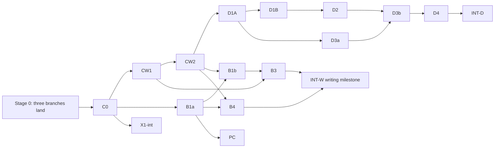

# BRN forward build sequence

**Status: proposed sequencing, prepared 16 October 2026 from main `cafb24c2`.** This file orders work that is already proposed. It assigns nothing and grants no implementation, merge or release authority. [Status](../../../status.md) remains the source of truth for current work.

**Owner decisions recorded here:**

- 15 October: `work/ui-polish` and `work/daily-workflow-reliability` land before the big work.
- 16 October: `work/cli-agent-contract` lands first too.

## Programs

| Program | Folder | State |
|---|---|---|
| Modular foundation and reference-assisted writing (workstreams A intake, B writing, C foundation/integration) | [modular-foundation](../modular-foundation/README.md) | Proposed, not started; reviewed pack stored in #147 |
| Agent capabilities, Rig-first (workstream D) | [agent-capabilities](../agent-capabilities/README.md) | Proposed, not started; reviewed and amended 16 October |

## Done so far

| Item | Result | Record |
|---|---|---|
| X1 Xberg PDF | Gates 1–2 passed; gate 3 design written. Bounded adaptation, not adopted | [x1-xberg.md](../modular-foundation/experiments/x1-xberg.md) (#150) |
| Z1 Zorite editor | Gate 1 passed, gate 2 failed. Not adopted; current editor retained | [z1-zorite.md](../modular-foundation/experiments/z1-zorite.md) |
| Passage-comment positioning (Z1 follow-up) | Reviewed prototype on the current Read viewer; needs a small `gpui-base` patch | Draft [#149](https://github.com/ewq100/brn-rust/pull/149); owner: do not merge |
| Rig-first plan review | Ready for Slice 0 after amendments A1–A9; Slices 3–4 need owner decisions | [REVIEW.md](../agent-capabilities/proposal/REVIEW.md) |

## Stage 0 — land the three finish-first branches

| Branch | Scope | Ahead of main (16 Oct) | Shares files with |
|---|---|---|---|
| `work/ui-polish` | `brn-desktop` only | 16 commits | reliability: `threads_ui.rs` |
| `work/daily-workflow-reliability` | runtime, core, app, retrieval, CLI, one desktop file | 29 commits | ui-polish: `threads_ui.rs`; cli-agent-contract: `brn/src/main.rs`, `brn-threads-app/src/lib.rs` |
| `work/cli-agent-contract` | CLI `--json` contract, keyed service functions, journey scripts | 9 commits | reliability: as above |

Each branch's own agent lands it with the [landing message](#land-a-finish-first-branch). Branches land in whichever order they finish, and the later branch resolves only the overlapping hunks. If two are ready together, land `ui-polish` and `cli-agent-contract` first, because they share no files, and then reliability.

**Gate:** all three on `main`. Nothing below starts before that, except the optional isolated experiment R0 (Rig reuse proofs; [message](#optional-now-r0-rig-reuse-proofs)).

## Stage 1 — combined C0

One integration lead (C) runs the modular-foundation C0 and the agent-capabilities Slice 0 together. The output is one baseline, one path-level ownership map and one integration ref, plus two short plans that link rather than repeat each other. Beyond both packs' C0 tasks, the lead also:

- records the reliability branch's `prepare_run` as the seam CW2 builds on;
- records whether the X1, Z1 and #149 results still hold on the integration ref (a record, not reruns, unless the relevant code moved);
- records the four Slice 0 decisions: model-limit source, summary storage, MCP transport and skill-manifest parser;
- obtains owner decision O1 (below).

## Stage 2 — build lanes



| Slice | Lane | Contents | Depends on |
|---|---|---|---|
| C0 | C | Modular-foundation C0 + D Slice 0 | Stage 0 |
| CW1 | C | Scoped writing setup and request v2, with any schema increment | C0 |
| CW2 | C | Reference binding, ledger/quotations on candidates, owner-Apply visibility gate, shared run start on `prepare_run` | CW1 (lane order) |
| B1a | B | UI-only extraction into `brn-writing-ui` | C0 |
| B1b | B | Panel on the shared run start; old writing path in `start_run` removed | B1a, CW2 |
| B3 | B | Brief/references UI, Sources used, reading statuses | B1b, CW1 |
| B4 | B | Development host over the real `Workspace` | B1a, CW2 |
| PC | B | Passage-comment positioning in Read, from the #149 prototype | B1a, decision T |
| INT-W | C | Writing milestone: applicable F-suite, review, native outline, program-status record | B3, B4 (+PC if started) |
| D1A | C | Cache-safe budgeted history; older-discussion access | CW2 (default order; O1) |
| D1B | C | Semantic summary in a derived cache | D1A |
| D2 | C | Continuation delta over the landed recovery work | D1B |
| D3a | helper | Skill packages: parse, validate, install/list/remove, in isolated files | D1A, decision D-S |
| D3b | C | Skill loading, frozen per-run catalogue, settings/composer | D3a |
| D4 | C | One opt-in read-only MCP connection | D2 (after D3b when D3 is started), decision D-M |
| INT-D | C | Agent-capabilities milestone (Slice 5) | The D slices the owner started |
| X1-int | A | Xberg replaces Poppler inside the restricted helper | C0, decisions X and L |

**Why this order:**

- Lane C is serial because every item touches `brn-ai/src/threads.rs`, core schema or the lockfile.
- CW1/CW2 go first because they unblock lane B; D slices unblock nothing else. D1A then budgets the final writing-request shape once.
- The critical path is C0 → CW1 → CW2 → B1b → B3 → INT-W. D1A–D2 overlap with B1b–B4.
- INT-W does not wait for any D slice. INT-D qualifies writing integration against whatever has landed.

**Capacity:** two build slots. The default is lane C plus lane B. D3a and X1-int take a slot only when lane B is idle, for example while B waits for CW2 after B1a. Never run two heavy native builds or benchmarks at once.

## Owner decisions

| ID | Decision | Needed before | If undecided |
|---|---|---|---|
| O1 | Lane C order: CW first (recommended) or D1A first | C0 exit | CW first |
| D-S | Installable instruction-only skills; amends the canonical target's fixed-catalogue paragraph and master plan C4 | D3a | D3 not started |
| D-M | One opt-in, read-only outbound MCP connection, as a narrow exception to deferred broad connectors | D4 | D4 not started |
| T | Toolkit-patch route for PC: vendored `[patch]` of `gpui-base` 0.7.3, upstream contribution, or maintained fork | PC | PC deferred; the comment list stays navigation |
| X | Xberg cutover approval | X1-int | Poppler retained |
| L | Live provider authority: D1B semantic qualification, I01, the X1-int Luna comparison | Each qualification | Recorded as blocked, not passed |
| Z | Publish `work/z1-zorite` (`b9bd1a1`) from the machine that holds it | Any time | Z1 record cites the #149 handoff |

## What this updates in the stored packs

The pack files stay unchanged as reviewed provenance. Where they differ, this sequence wins:

| Stored text | Update |
|---|---|
| modular-foundation [README](../modular-foundation/README.md) and `final/00` owner decision (two branches land first) | Three branches land first |
| `final/00` bootstrap message | Replaced by the [combined C0 message](#after-all-three-land-combined-c0) below |
| `final/01` section 3, overlapping-work row | Superseded by the Stage 0 table |
| `final/01` section 11, "Experiments before C0" | X1 and Z1 are done. Only R0 remains as an early isolated experiment |
| `final/01` section 12 slice table | Extended by the D slices, PC and X1-int above |
| `final/01` section 17 experiment results and Editor row | X1 and Z1 recorded as above. Current editor retained; positioning pursued on the current viewer (PC) |
| `final/01` section 10 C4, "no dynamic skill platform" | Scoped by decision D-S |

## Launch messages

### Land a finish-first branch

Give this to the agent that owns each branch.

```text
Land <BRANCH> on main. Owner authority for this message: push, open a PR and
merge it after the required checks. No release.

1. In the branch's own worktree, finish and commit outstanding work. Fetch
   origin and merge origin/main into the branch (no rebase, no force-push).
   Resolve only overlapping hunks, keeping both sides' intent. Known overlaps:
   crates/brn-desktop/src/threads_ui.rs (ui-polish x reliability);
   crates/brn/src/main.rs and crates/brn-threads-app/src/lib.rs
   (reliability x cli-agent-contract).
2. Run the branch's recorded verification, plus cargo fmt --check, strict
   clippy and the default workspace tests; for desktop changes also the
   native-ui build and tests. Record exact results in the branch's evidence.
3. Push, open a PR and wait for the four required checks: Core and CLI
   (ubuntu-24.04), Core and CLI (macos-15), Native UI build and state
   (macos-15), Native retrieval and combined build (macos-15). If main moves,
   merge it again and wait again. Merge with a merge commit
   (gh pr merge --merge). Report the PR number and merge SHA.

Do not touch other branches, draft PR #149 or real data.
```

### Optional now: R0 Rig reuse proofs

```text
Isolated experiment R0 (Rig reuse proofs) for BRN. Authority: this message only.

Read section 4 of
docs/work/active/agent-capabilities/proposal/amended/BRN_Rig_First_Implementation_Plan.md
and the current AGENTS.md at origin/main. Record the origin/main SHA you start
from.

- Worktree .worktrees/r0-rig-reuse on new branch work/r0-rig-reuse from that
  SHA. Change only experiments/r0-rig-reuse/: its own Cargo.toml with an empty
  [workspace] table, its own Cargo.lock seeded from the root lock, and
  CARGO_TARGET_DIR=/private/tmp/brn-r0-target. Pin rig =0.44.0 with only the
  features each proof needs (memory, rmcp, test-utils). Rust 1.98.1.
- Credential-free proofs with Rig's scripted/test facilities:
  1. TokenWindowMemory/MemoryPolicy applied explicitly at run start with no
     automatic canonical message writes; a stub Compactor invoked; confirm
     CompactingMemory summary state is process-local.
  2. Prefix stability: inside one run each request prefix is byte-identical
     to the previous request; two runs between compaction boundaries share the
     history prefix.
  3. rig-rmcp: tool conversion, cancellation and list-change refresh against
     an in-process rmcp 2.x server. Record which transport features resolve
     and the lockfile delta, including duplicate reqwest/schemars versions.
  4. AgentRun round trip: list every retained payload field; show that direct
     driving skips configured hooks/tools/memory.
- REPORT.md: pass/fail per proof with exact commands and outputs, dependency
  and lockfile delta, limits. Time-box about 3 hours. Commit locally; ask
  before pushing.

No production or shared files, provider calls, model downloads, real data,
computer use or merge.
```

### After all three land: combined C0

```text
Bootstrap mode, combined C0 only. You are the single integration lead (C) for
two proposed programs. Read at current origin/main:
- docs/work/active/build-sequence/README.md (it wins where the packs differ);
- docs/work/active/modular-foundation/proposal/final/01-master-plan.md and
  02-foundation-lead-prompt.md;
- docs/work/active/agent-capabilities/proposal/amended/
  BRN_Rig_First_Implementation_Plan.md (Slice 0 is section 4).

1. Inspect actual state: branch/HEAD, fetched origin/main, every local
   worktree (including unpushed and uncommitted work), open PRs and running
   processes. Read the current repository AGENTS.md and status. If an
   injected guide conflicts with them, report the conflict and follow current
   repository guidance and my explicit authority here.
2. Owner decisions (15-16 October 2026): work/ui-polish,
   work/daily-workflow-reliability and work/cli-agent-contract are merged
   before this program starts. Confirm all three are on main. If any is not,
   stop and report. Preserve all other unmerged work; do not merge draft
   PR #149.
3. Run relevant baseline checks with exact commands and features, covering
   the four required CI lanes. Record pre-existing failures separately; do
   not hide, skip or weaken anything.
4. Install docs/work/active/modular-foundation/plan.md (baseline, path-level
   ownership for both programs, the section 7.2 contract, section 13 scenario
   IDs and applicability, the F22 default-build rule) and
   docs/work/active/agent-capabilities/plan.md (capability matrix, reuse
   decisions, acceptance IDs, blockers), both linked from status. The second
   links the first's baseline and ownership instead of repeating them.
5. Slice 0 reuse proofs, credential-free, in experiments/ only; reuse R0's
   results if it ran, recording its snapshot and whether it still holds.
   Record the four decisions: model-limit source, summary storage, MCP
   transport, skill-manifest parser. Add no production dependencies.
6. Record the reliability work's prepare_run as the seam CW2 builds on, and
   whether the X1, Z1 and #149 results still hold on your integration ref.
7. Do not implement CW or any D slice. Commit a C0 integration ref that adds
   no new failing or skipped required tests, and record it.

Finish with: the factual baseline and pre-existing failures; the integration
ref; the ownership table; the Slice 0 decisions with evidence; open owner
decisions (O1, D-S, D-M, T, X, L); and precise start messages for CW1 and B1a.

Local work and local commits only, on synthetic data. No push, merge, release,
real-data use, model download, paid or live provider calls, or computer use.
```
