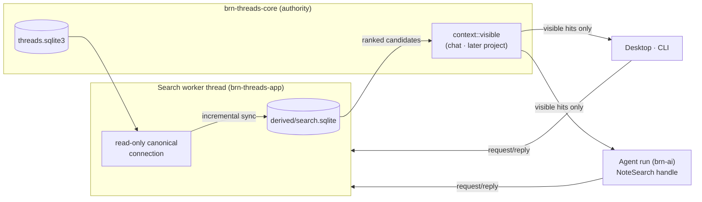

# Knowledge and retrieval architecture

**Date:** 13 October 2026. **State:** ACCEPTED. The owner accepted D6 and D7, then D1–D5, on 13 October 2026.

**Owner request:** "Make a new plan and architecture so we can start building it." The request follows the knowledge-system research, the English-first decision, and the owner's move from Threads to **Chats and Projects**.

**Goal:** BRN stays useful at 5,000–10,000 notes:
- The agent can find and read the right knowledge within its tool budget, in every chat.
- The owner gets fast, relevant search and topic navigation.
- Chat-only and (later) project-only material never leaks into general results.
- Retrieval is English-first, and Estonian can be added later by rebuilding the derived index.

## Inputs this design builds on

These are separate branches; none is merged to `main` at `65119a7`.

| Work | Branch | What it fixes for retrieval |
|---|---|---|
| Standalone chats, stage 1 (merged in [PR #130](https://github.com/ewq100/brn-rust/pull/130)) | `codex/thread-product-discovery`, spec and plan in `docs/work/active/chats-and-projects/` | `Note.chat: Option<String>` visibility. Core `context::visible`, `Store::records_for_chat` and `record_visible_in_chat` as **the** visibility predicate. Schema v4 with a backed-up upgrade. Scoped runtime reads; the nine tools are preserved. UI says Chat; internal Thread IDs stay. |
| Projects, stage 2 (deferred) | Same brief | Project-only notes and chats. A project-wide "Use BRN knowledge" setting. Automatic search of relevant earlier chats **in the same project**. Visibility must cover agent reads, relevant-chat search and current-input validation. |
| Ordinary wiki guidance (owner-selected direction) | [PR #129](https://github.com/ewq100/brn-rust/pull/129) (merged, `codex/ordinary-wiki-guidance`); UI prototype `codex/ordinary-wiki-ui-prototype` | Ordinary notes are source-grounded subject pages. **Roles are writing conventions, not record kinds.** Topic pages are ordinary index notes with links; relation strings are free (`source`, `related`, `explains`, `compares`, reusing an existing equivalent). Provenance lives in change-request input versions, links and prose. **Topic pages and search are the primary navigation, with a local graph under Connections** (8 neighbours, a deliberate second hop, optional sources, shown/available counts and a readable list). The selected search UI pages results at 12 per page, with exact counts and matching context. Guide bundle `brn-threads-guidance-3`. A Python live before/after harness (`scripts/evaluate-wiki-guidance.py`). No schema, retrieval engine, metadata or taxonomy changes. |

This architecture owns the **retrieval engine** that those branches deliberately left unchanged. It does not redefine chat, project or wiki behavior. PR #129's research states the dependency directly: "If relevant knowledge cannot be retrieved reliably, fixing retrieval has priority over forcing a taxonomy."

**Evidence from PR #129's primary research that shapes this design** (`docs/research/llm-wiki-primary-research.md` on that branch):
- **A July 2026 progressive-disclosure study on a 709-page wiki.** Summaries plus keyword-ranked retrieval cut answering cost by about 30–34% at non-inferior quality. Hence compact ranked results first, then section reads.
- **WiCER (May 2026).** Blind compilation can drop critical facts. Hence search must keep reaching underlying evidence, not only synthesized pages.
- **EvalMem (September 2026).** An auxiliary summary surface helps only when a quota (30%) stops summaries crowding out original evidence. Hence the evidence quota in §3.
- **A preregistered wiki-versus-RAG comparison.** The wiki used about 21× the query tokens. Hence bounded, compact tool output.

## Current retrieval baseline (verified in source, `65119a7`)

- **App search:**
  - `Workspace::search` uses an **in-memory** FTS5 index. It rebuilds it on the first search after every open.
  - Tokenization is `unicode61 remove_diacritics 2`, with BM25 ranking, top 30, and one row per passage.
  - Fixed 1,600-byte passages have no heading context.
  - `fuse_hits` (RRF) exists but is unused.
- **Dense search:** an optional pinned MiniLM model (384-d, 128 tokens) that app search does not use.
- **Agent:** no ranked search. `read_records` does a literal scan over full records, returning up to 100 of them, each up to 128 KiB. Runs default to 8 tool rounds. **This is the most important gap at scale.**
- **Data directory:** `Store::open` refuses entries other than the marker, the database and its WAL/SHM files.

## Architecture

### 1. Search worker (concurrency)

- **One dedicated search worker thread** owns two connections: a read-only connection to the canonical database and the only writer to the derived index.
- The desktop UI, the CLI and each agent run hold a cloneable `SearchHandle` (a channel sender). They exchange messages with the worker and never share a rusqlite `Connection`, which is `Send` but not `Sync`.
- Each request:
  1. Reads one canonical snapshot.
  2. Incrementally syncs changed `(id, version, sha256)` notes and links.
  3. Queries the index.
  4. Checks visibility.
  5. Replies.

  The agent's own applied changes are therefore searchable within the same run.
- Within a process the worker is the single serializer of derived writes. Separate processes (the desktop and a CLI) each run a worker against the same file. Their writes serialize through `BEGIN IMMEDIATE` and busy timeouts, opens and rebuilds go through the advisory lock, and a worker whose snapshot is behind the shared index retries on a fresh snapshot.

### 2. Derived index (`brn-retrieval::search_index`)

- **Identity and rebuild.** A lean schema with identity `BRNS` (v2 since Task 5: passage IDs are never reused), independent of the vault-era `NoteIndex`, which Task 6 retired. An outdated or settings-mismatched index is rebuilt in place in one transaction, and a damaged one is replaced; neither is ever repaired. Both happen under an advisory `derived/search.lock` shared by every BRN process. This replaced the planned sibling swap, which could strand WAL files and race across processes. A foreign file is refused unchanged.
- **Tables:**
  - `docs(id, kind, version, sha256, title, visibility, protected, imported, language)`. `kind` is `note` now; `message` is reserved for project chat search. `visibility` is `general`, `chat:<id>` or, later, `project:<id>`.
  - `passages(id, doc, start_byte, end_byte, heading_path, text, indexed_text)`. `indexed_text` is `title › heading path` followed by the passage text. Byte ranges point into the saved Markdown, so quotes and anchors stay exact.
  - FTS5 `fts_exact` (`unicode61 remove_diacritics 2`) and `fts_stem` (`porter unicode61 remove_diacritics 2`). Both are external-content tables over `passages.indexed_text`, each with its **own insert and delete triggers** using `old.indexed_text`, so no stale terms survive. A change to a title or heading re-chunks the whole document.
  - `vectors(passage, model, blob)`.
  - `links(from, to, relation)`, mirrored from core Link records.
  - `meta`: `chunker_version`, `analyzer_version`, `embedding_model`, `embedding_dimension`, `default_language=en`. Any mismatch triggers a rebuild.
- **Analyzer registry keyed by language.** Only `en` is registered, using the `porter` table. Estonian would be a later analyzer writing pre-stemmed text; that is a rebuild, not a migration.
- **Markdown chunker v1:**
  - Splits at ATX headings, then at paragraphs.
  - Keeps fenced code and tables whole up to a 4,000-byte hard cap, targeting about 1,200–2,000 bytes.
  - Records the heading path for each chunk.
  - Is deterministic.
- **Sync position.** `meta` stores the canonical watermark (`max(rowid)` of `revisions`, which rises with every record write) and the workspace identity (its first operation). A watermark that moves backwards, or a different identity, causes a full resync.
- **Eligibility.** `docs.visibility` is core's `search_eligibility`, derived from `visible`: `general`, `chat:<id>` (the note's own chat or its import Source's chat) or `hidden`. Hidden notes stay indexed so a Source change can re-derive them. Archived and superseded notes are removed.
- **Location (D1).** `derived/search.sqlite` sits inside the workspace. Core allowlists one real `derived/` directory and rejects symlinks there and in its ancestors. Backup already snapshots only SQLite, and restore creates a fresh directory, so the derived index is naturally excluded and rebuilt.

### 3. Query and visibility

- **Pipeline:**
  1. Filter eligibility first, using the caller's context: `general` plus `chat:<current>`; later, project rules.
  2. Run `fts_exact` and `fts_stem`, each limited to 50, plus an all-words `fts_stem` lane when the query has more than one word.
  3. Run dense search, limited to 50, when vectors exist for the configured model.
  4. Fuse with RRF, k=60.
  5. Collapse to one result per document: best passage, number of matching passages, heading path.
  6. **Re-check each candidate with the core visibility predicate** before it is returned. Core stays the authority; the index filter is only an efficiency.
  7. Overfetch so that rejected candidates do not starve the page.
- **Evidence is not crowded out.** When a page has more than 3 results, reserve at least 30% of its slots for imported references and source-linked evidence notes, if any matched. Synthesized subject pages cannot then hide the evidence behind them. Tune this on the Task 0 evaluation set.
- **Pages report exact totals.** A response returns `total` visible matches, `shown` and an opaque `cursor`. This supports the selected UI (12 per page, exact counts, matching context) and lets the agent see that more results exist.
- **Context comes from the host,** never from model arguments:
  - The agent handle is bound to the run's chat.
  - The UI passes the owner's current context.
  - Ordinary general search excludes chat-only notes, matching the chat branch's `Workspace::notes()`.
- **Semantic coverage is reported** as `semantic: none | partial(n/m) | complete`. Keyword search is always available, and there is no hidden fallback between models.

### 4. Agent tools (`brn-ai`)

- `brn-ai` defines `RunNoteSearch: Send + Sync` (built as `search(chat, query, limit, cursor)` and `connections(chat, id, hops, sources)`, where `chat` is always the run's host-validated chat).
- `ThreadRunRequest.search: Option<Arc<dyn NoteSearch>>` carries the host's handle, already bound to the run's chat context.
- `brn-ai` does not depend on `brn-retrieval`.
- **`search_notes`** `{query, limit ≤ 20, mode: hybrid|keyword}` returns compact results only: `id`, `version`, `title`, `heading_path`, a snippet of at most 300 bytes, `start`, `matches`, `protected`, `imported`, and `semantic`. The agent continues with `read_note` at that version and offset.
- **`note_connections`** `{id, hops: 1|2}` returns the bounded recorded neighborhood: at most 8 neighbours per hop, typed relations, titles and counts. It matches the owner-selected **Connections** view and is visibility-checked.
- The tool catalog grows from 9 to 11 when the host supplies search. Guides keep `read_records` for exact IDs and point discovery at `search_notes`.
- **Guide edits build on PR #129's text.** In particular, `maintain-notes` step 1 currently says to search with `read_records` and that "the bounded result is not a complete workspace catalog". It becomes: search with `search_notes` using the subject's names and terms (2–3 reformulations when important), use `note_connections` for the subject's neighbourhood, then read sections with `read_note`. Keep PR #129's provenance model (input versions, prose attribution) and add no citation syntax. Recommend the D7 relation names while allowing others, and describe the root Topics note (D6). Make one guide-identity bump after `brn-threads-guidance-3`.

### 5. Topic navigation support (ordinary wiki direction)

- Topic pages stay **ordinary linked notes**. There is no role field or record kind (PR #129).
- **Root Topics note** (owner-accepted refinement, 13 October 2026):
  - One ordinary note links to every topic page. The Topics tile lists exactly what it links to, in its order. This is Karpathy's `index.md`, kept as a BRN note.
  - **Finding it:** its ID is stored in an optional serde-default `WorkspaceSettings.topics_note`, like `theme`, with no SQL change. Titles can change, so the title is not used.
  - **Creating it:** the app creates it on first use as an owner action. Setting or replacing the pointer is owner-only configuration.
  - **Maintaining it:** the AI maintains the note's content under the existing delegation, using ordinary checked writes, protection and Undo. The host puts its ID in run context, so the agent never guesses which note it is.
  - **Topics outside it:** a topic page missing from the Topics note stays reachable through search. Under the knowledge check, a note that looks like a topic page but isn't linked from Topics is a finding.
  - **Projects:** later, each project can have its own topics pointer.
- **Recommended relations** (owner-accepted refinement, not enforced):
  - The code understands four relation names:
    - `source`: the note draws on this evidence;
    - `supersedes`: this replaces that;
    - `contradicts`: unresolved conflicting claims;
    - `related`.
  - Any other concise name remains allowed and is shown as written. PR #129's `explains` and `compares` are examples.
  - Known names drive these behaviors:
    - Connections labels and filters;
    - the evidence quota (§3; `source` targets and imported references count as evidence);
    - knowledge-check findings for supersession and contradiction.
  - The knowledge check flags near-duplicate relation names (for example `relates-to` next to `related`) so the agent can normalize them.
  - Core does not validate relation names.
- Retrieval also supplies derived signals:
  - The link mirror powers Connections, for both the UI and the agent.
  - Search results show inbound-link counts.
  - The UI can sort subjects by inbound links. Ranking is not changed.
- **Knowledge check** (optional, later, owner-triggered; no scheduled work). Its deterministic findings are those PR #129 says can actually be established:
  - valid references and links to missing or archived notes;
  - recorded evidence versions that are no longer current;
  - version conflicts;
  - available source coverage gaps;
  - orphans;
  - duplicate or near-duplicate titles and content.

  The findings seed one chat, so the agent's bounded health review from `maintain-notes` can act on them. A clean check is not proof of correctness.

### 6. Dense upgrade (`native-retrieval` feature)

- Replace the MiniLM profile with a pinned **`multilingual-e5-small`**: 384-d, 512 tokens, MIT licence, `query:` and `passage:` prefixes. As built: `Xenova/multilingual-e5-small` at `761b726d…`; an existing MiniLM install is still recognised. Measured on the golden set (Task 5 evidence), the dense lane only adds notes the keyword lanes missed, never reorders keyword matches, and counts a semantic match only at cosine ≥ 0.82 and when the best match stands 0.017 above the background. With those settings, unrelated queries still find nothing and no stratum regresses.
- `multilingual-e5-base` (768-d) is the alternative if the English evaluation favors it clearly.
- Assets are pinned by revision, size and digest. The download stays an explicit owner action.
- A background embedding queue runs inside the search worker in bounded, cancellable batches.
- Vectors are held in one contiguous in-memory matrix and scanned by brute force. Add an ANN index only if measured p95 latency fails.

### 7. Projects stage (reserved, not built here)

- When projects arrive:
  - `visibility` gains `project:<id>`.
  - `kind=message` indexes chat messages for "find relevant earlier chats in this project".
  - The project's "Use BRN knowledge" setting decides whether `general` is eligible for its chats.
- Eligibility and the core re-check enforce this for UI, CLI and agent alike. Nothing in stages 1–6 needs to change shape for it.

## Decisions (accepted 13 October 2026)

| ID | Decision | Recommended | Alternative |
|---|---|---|---|
| D1 | Index location | Allowlist one `derived/` directory in the workspace | An OS cache directory keyed by workspace (no core change; harder to find and clean up) |
| D2 | Concurrency | A dedicated search worker plus a message `SearchHandle` | A mutex-shared service (risks lock ordering and `!Sync` connections) |
| D3 | Embedding model | Pinned `multilingual-e5-small` | `multilingual-e5-base` |
| D4 | Agent wiring | A host-bound `NoteSearch` trait in `brn-ai` | `brn-ai` opens the index directly (couples AI to retrieval) |
| D5 | Sequencing | Build on top of chat stage 1 and PR #129 after both merge; Task 0 can start now | Build on `main` now and rebase over both (large conflicts in `lib.rs`, `threads.rs`, `store.rs` and the guides) |
| D6 | Topic page listing | **Accepted:** a root Topics note found through `WorkspaceSettings.topics_note` | Guessing from links (unreliable) or a `Note.role` field (schema and authority cost) |
| D7 | Relation names | **Accepted:** recommended `source`, `supersedes`, `contradicts` and `related`; others allowed | Free names only (drift weakens Connections, the evidence quota and checks) or an enforced list (too rigid) |

## Non-goals

- Estonian tuning.
- Project features.
- Note role fields or taxonomies.
- Graph RAG and LLM entity extraction.
- Vector databases.
- Hosted embeddings.
- Rerankers.
- LLM chunk context.
- Long-context stuffing.
- Scheduled or background agent work.
- Live provider calls in automated checks.

## Acceptance

- **Golden-set evaluation:** on the synthetic English golden set, hybrid keyword recall@10 improves over today's baseline, with no stratum regressing.
- **Performance at 10,000 synthetic notes on the target Mac:**
  - Reopen does not rebuild.
  - A one-note sync takes < 50 ms.
  - Query p95 is < 150 ms.
  - Cold build time is recorded.
- **Visibility:** chat-only notes never appear in general search or in another chat's agent search. Guessed IDs, snippets, connections and counts are covered.
- **Agent fixtures at 10,000 notes:**
  - Retrieval: find and read the target section within 3 tool rounds.
  - Maintenance: search, read, prepare and apply within 8 rounds, including a stale-candidate case.
- **Existing behavior is preserved:** checked writes, protection, chat queue and steering, Undo, export, backup/restore and upgrade.
- **Dense lane:** semantic evaluation runs only with an installed pinned model, as an owner-run qualification.
