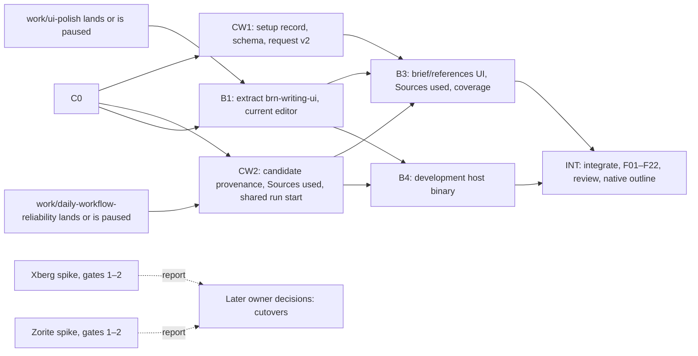

# Plan review: BRN modular foundation and reference-assisted writing

**Reviewer role:** independent principal architect. This is a plan review only: no production change, no install, no commit, no build.
**Date:** 15 October 2026
**Inputs reviewed:** pack files 00–06, read in full. The originals are unchanged; byte-identical copies are in `original/`.
**Outputs:**

- this report;
- `amendments.patch`, a unified diff across all seven pack files that was dry-run, applied and reproduced exactly;
- `amended/`, the pack with the patch applied.

## 1. Verdict

### READY FOR C0 AFTER NAMED AMENDMENTS

The product intent, the preserved-behavior list (§4) and the honesty rules are sound. Five corrections are needed before C0 freezes contracts and ownership (R1–R5, below).

| | |
|---|---|
| **Can start now** | C's read-only Bootstrap inventory and plan install. The Xberg and Zorite gate-1/2 spikes in their own worktree under `experiments/`; they touch no shared code. (Do not use the untracked `experiments/` folder in the owner's main checkout.) |
| **Waits for C0 exit** | C's shared writing changes (CW1). |
| **Waits for `work/ui-polish` to land or be owner-paused** | B1, the writing UI extraction. |
| **Waits for `work/daily-workflow-reliability` to land or be paused** | CW2 (run start and candidate provenance in `brn-ai/src/threads.rs`) and any production intake edits. |
| **Not ready** | Full parallel build, dependency cutovers, release. |

## 2. Prioritized findings

### F1 — HIGH — Confirmed defect: the launch plan collides with live local work

**Where in the pack:** 00 "Recommended launch sequence" steps 2–3 and the two-slot paragraph; 01 §6 C0 exit; §11; §12 (B1 depends only on C0).

**Evidence.** Inspected `main@771116f`, `origin/main = b139221` (unchanged since the pack), and 27 worktrees. Two worktrees are active today and unpushed:

- **`work/ui-polish`** (`13d6224e`, 08:39). Changes 17 `brn-desktop` files, including `threads_ui.rs` (±570 lines) and `threads_writing.rs`. Its plan redesigns the comments section, writing bar and review bar, which are B1's extraction targets.
- **`work/daily-workflow-reliability`** (`3a7c3d25`, 08:24). 8 commits plus 5 uncommitted docs. Touches `brn-ai/src/threads.rs`, `run_lease.rs`, `brn-threads-core/src/{edit,lib}.rs`, `brn-threads-app/src/{intake,chat}.rs`, `brn/src/main.rs` and desktop `threads_ui.rs`.

The pack itself acknowledges that GitHub cannot show local work, but its order and two-slot rule ("run A and B together") ignore it.

**Failure scenario.** B moves `impl ThreadsUi` writing code into a new crate while ui-polish restyles the same functions. One owner-requested change is lost or re-implemented. Moving run start out of `threads.rs` conflicts with the run-lease changes. Two slots are already occupied, so the order would create four concurrent writers.

**Correction (R1):** name both branches as owners of their files; gate B1 behind ui-polish and CW2 behind the reliability branch; count active branches against build slots. Affects C0, B and C.

### F2 — HIGH — Evidence gap: writing-context semantics are undefined where they matter

**Where:** 01 §7.2 ("through existing shared records wherever suitable"); §9 B3; 04 B3.

**Evidence.**

- `WritingSnapshot` (`brn-threads-core/src/writing.rs`) binds the note, comments, all linked-thread messages and the request marker as `Current` inputs, within 128 KiB.
- Comments require a `discusses` link (`brn-threads-app/src/writing.rs:157–215`).
- The writing thread is chosen by UI heuristic (`threads_ui.rs:1128–1145`).
- Scope is one predicate keyed by conversation (`context.rs::visible`). Projects share one note across projects. Delegated maintenance edits ordinary notes.
- `InputExpectation::Historical` already exists.

**Failure scenarios.**

- **(a)** References bound like comments (`Current`): any edit to an ordinary reference, including standing delegated maintenance, makes pending candidates stale. In an active workspace, Apply may never succeed.
- **(b)** Brief stored on the Note: editing it bumps the note version and makes pending proposals stale.
- **(c)** Note N is shared in projects P1 and P2. Reference R is private to P1. A P2 conversation rewrites N; with no per-request scope rule, R reaches the P2 run.
- **(d)** B and C answer these differently in parallel, forcing integration rework.

**Correction (R2):** replace §7.2 with decided semantics:

- one owner-only writing-setup record per note;
- per-request scope taken from the linked conversation through the existing `visible()` predicate;
- request v2 that captures IDs and versions only;
- setup record bound as `Current`;
- references actually read bound as `Historical`, with visibility rechecked at Apply;
- "Sources used" built from a persisted read ledger.

Owned by C; consumed by B.

### F3 — HIGH — Confirmed defect: the boundaries would force duplication and break a required check

**Where:** 01 §5 table and paragraph; 02 Bootstrap step 5; 04 B1/B4.

**Evidence.**

1. Headless writing already exists in `brn-threads-core::writing` and `brn-threads-app::writing`. Forbidding the writing engine from depending on `brn-threads-app` forces host traits with one implementation, yet the development host must use the real service anyway. `brn-threads-app` has no GPUI dependency.
2. Real orchestration lives in `ThreadsUi::start_run` (`threads_ui.rs:1892–2030`): settings to provider/model/effort, search handle, worker thread. The CLI duplicates selection (`brn/src/main.rs:339`). The pack never names moving it, so a development host must copy it, contradicting "no copied workflow".
3. The required `Core and CLI (ubuntu-24.04)` job runs `cargo build/clippy/test --workspace` with default features (`ci.yml:85–91`). A new crate with a non-optional `gpui-kit` dependency compiles GPUI on Linux.

**Failure scenario.** The host passes F18 by copying `start_run`. A later provider-selection fix lands only in desktop, and the host (and the future Writer) silently diverge. Or the new crate breaks the Linux job.

**Correction (R3):** no `brn-writing` crate or host traits. Create one `brn-writing-ui` crate that depends on `brn-threads-app` and an optional `gpui-kit`, never `brn-desktop`. C moves run start and conversation selection into shared code. Add F22 (default Linux build compiles no GPUI).

### F4 — MEDIUM-HIGH — Trade-off: C is overloaded and rebuilds what exists

**Where:** 01 §7.3; §10 C1–C4; §12 C1/C2; 02 Build mode.

**Evidence.** These already exist:

- scoped `search_notes`, `read_note`, `read_note_range` and `note_connections` tools under host-fixed `Scope.chat` (`brn-ai/src/tools.rs:557–725`, `threads_search.rs`);
- the single `visible()` predicate;
- `ReadLedger` coverage accounting (`threads_reads.rs`);
- host quote verification (`threads_research.rs:1017–1133`);
- the retrieval harness and 10k scale test (#131–#134), a mutation pilot (#146), and extensive core tests (`core.rs` about 2.8k lines, plus current-input, candidate-refresh, steering and delegation tests).

The pack still asks C for an evidence adapter, context consolidation, retrieval strengthening with recall/latency comparisons, provider/runtime clarification and an invariant-wide audit, on top of schema, lockfile, CI and integration. The canonical target says: "Avoid simultaneously rewriting storage, orchestration, desktop framework, editor engine, and provider transport" (`threads-target.md`, Editor section).

**Failure scenario.** B3 waits on a "C1 evidence adapter" that wraps existing tools. Retrieval benchmarks spend scarce build slots on a refactor whose only requirement is non-regression.

**Correction (R4):** C's work becomes C0, CW (the four shared writing changes), regression tests for touched invariants, and integration. Defer C2–C4. Run retrieval evaluation only if retrieval code changes.

### F5 — MEDIUM — Trade-off and evidence gap: dependency evaluations lack concrete targets and sit on the critical path

**Where:** 01 §8 A2–A5; §9 B2/B4; §12 (C3 requires A3, and B4 requires B2); 03; 04.

**Evidence.** The canonical target says to evaluate an editor "only against a concrete missing capability". The intake boundary already exists (#144). The verified external facts are in §5.

**Failure scenarios.**

- A locked Mac keeps Zorite's IME gate open, so B4 and C3 cannot close even though writing works.
- Choosing Kreuzberg 4.10.4 creates an `ort` links conflict with fastembed.
- Xberg replaces readers qualified yesterday with no demonstrated gap.

**Correction (R5):** both become time-boxed `experiments/` spikes with staged kill gates and named targets:

- Xberg: remove the Poppler runtime dependency for PDF prepared evidence.
- Zorite: range geometry, WYSIWYG, IME.

Cutovers become separate later decisions.

### F6 — MEDIUM — Confirmed defect: an unnecessary A→B contract

**Where:** 01 §7.1 and §11 ("B consumes the same contract fixtures…"); 02 step 7; 04 B3 ("file imports through A's agreed result contract").

**Evidence.** `RewriteNote` runs reject transient sources (`brn-ai/src/threads.rs:1799`). A reference must be a note, and full-note import already produces scoped protected notes.

**Failure scenario.** C0 freezes a conversion API for B that B never calls, and every A change churns B.

**Correction:** included in R3. B consumes notes; file import plus attach uses the existing import path.

### F7 — MEDIUM — Evidence gap: the "Sources used" seam is unnamed

**Where:** 01 §7.2/§7.3; §9 B3.

**Evidence.**

- `writing_request()` replaces the model's declared inputs with the snapshot's (`threads.rs:851–862`).
- `ReadLedger` is in-memory per run and only surfaced in helper reports (`threads_research.rs:950`).
- Traces are opt-in and record structure only.

**Failure scenario.** B builds the panel, but no persisted evidence exists. B either infers sources from model text (an invented bibliography) or blocks.

**Correction:** R2 plus CW item 3. Persist ledger entries and `Historical` inputs on the candidate.

### F8 — LOW — Evidence gap: revocation on the owner-review Apply path

**Evidence.** `review_apply` uses `HostAuthority::owner` (`review.rs:15–19`). The core rechecks input visibility only under chat-bound authority (`store.rs:1183–1213`).

**Scenario.** A reference is revoked mid-run, the owner applies, and private wording enters a general note without notice.

**Correction:** a C0 failing-first test, with a fix if needed (in R2/F10).

### F9 — LOW — Trade-off: process overhead

Five C0 documents plus per-stream files contradict the workflow's "keep one short active plan". **Optional:** one `plan.md` plus `evidence.md` when results exist (included in the patch).

### F10 — LOW — Operational: stale injected guide

This review's own session was injected with a pre-`c7e3eda3` `AGENTS.md`: "production paused", PR85, and the removed `brn-store` and `brn-workflow` crates. Sessions launched the same way may follow it. **Optional:** launch messages say to read the repository `AGENTS.md` at the ref (included in the patch).

## 3. Simplified execution plan

| Decision | Items |
|---|---|
| **Keep** | §4 non-negotiables; one integration lead; status taxonomy (implemented → released); F-suite structure; honest native/Mac gates; negative decisions are valid; no NoteGen/Zed/Zorite-app fork; #112 not merged; package-vs-workspace and `ort`/feature caution; "retrieval expert" means a service, not a mandatory agent. |
| **Change** | §7.2 semantics (R2); §5 boundaries (R3); C0 deliverables and exit; slice order (§12); F04, F08, F10, F18; new F21 (cross-scope reference) and F22 (default Linux build). |
| **Remove** | Headless `brn-writing` crate and host traits; conversion contract for B; the "C1 evidence adapter" slice; editor adapter as a public trait while one editor exists. |
| **Defer** | C2 context consolidation; C3 retrieval boundary and evaluation; C4 provider/runtime reorganization; invariant-wide audit and mutation campaign; Xberg/Zorite cutovers; unsaved-snapshot requests. |

**Minimum C0 deliverables:**

- reconciliation of active work;
- one `plan.md` with baseline, path-level ownership, contracts and coordination;
- failing-first tests for the §7.2 contract (setup record, request v2, `Historical` reference inputs with owner-Apply visibility, ledger-based Sources used);
- the F22 CI rule;
- a committed integration ref;
- spike locations.

**Order:**

**Ownership by path:**

| Owner | Paths |
|---|---|
| A | `experiments/xberg-*` only. No production intake edits during the spike. |
| B | `brn-writing-ui`, desktop writing files (after ui-polish), `experiments/zorite-*`. |
| C | Core/app writing operations, CW changes in `brn-ai/src/threads.rs` (after the reliability branch), schema, manifests/lockfile, CI, docs. |

**Conditional adoption gates:**

- **Xberg** `=1.3.10`, `pdf` feature only:
  1. dependency graph with no downloads;
  2. schema-2 PDF evidence, including rasterization, versus Poppler on existing inventories;
  3. integration design inside the existing restricted helper.
- **Zorite** `=0.11.2`:
  1. compiles against `gpui-kit 0.7.3` / `gpui-pre 0.3.9` with no patches;
  2. offsets, read-only wrapper, and WYSIWYG mapping agree with BRN's Read view;
  3. native IME, selection and geometry.

**Do not run concurrently:**

- B1 with ui-polish;
- CW2 with the reliability branch;
- two heavy native builds or benchmarks;
- more build streams than slots (the active branches count).

## 4. Actionable amendments (`amendments.patch`, 33 hunks)

**Required:**

| ID | Content | Patch locations |
|---|---|---|
| R1 | Active-work sequencing and capacity | 01 §3 new rows, §6 tasks/exit, §11 "Active work and capacity", §12; 00 steps 2–3 and two-slot paragraph; 02 Bootstrap step 6; 03/04 ownership paragraphs |
| R2 | Writing semantics | 01 §7.2 replacement; §7.3 reuse note; F04, F08, F10, F21; 02 Bootstrap step 5; 04 B3; 05 item 4; 06 steps 3 and 10 |
| R3 | Boundaries | 01 §5 table and paragraph, §7.1 note, §7.4 seam note, B1/B4; F18, F22; 02 step 5; 04 B1/B4; 05 item 2; 06 step 15 |
| R4 | C scope | 01 §1 bullets, §10 scope note, CW, deferral markers on C2–C4; 02 Build-mode header |
| R5 | Dependency spikes | 01 §8 framing, A2, A5; §9 B2, B5; §12; §17; §18 verification; 03 objective, A2, A4 note, A5; 04 objective and B2; 00 table and defaults; 05 item 6; 06 setup rows |

**Optional:**

- consolidated C0 documents (01 §6 deliverables; 02 step 4);
- stale-guide launch note (01 §11; 00 bootstrap message);
- F01/F13 applicability notes.

These are in the same patch; drop those hunks if not wanted.

## 5. Evidence and limits

**Repository inspection** used a read-only `git archive` of `b139221` plus live `git worktree`, `git ls-remote` and `gh pr list`:

- `AGENTS.md`, status, roadmap;
- architecture overview, dependencies, invariants, and the target sections on the persistent model and editor;
- workflow and verification docs; the writing-polish and rust-luna-intake plans; the ui-polish and reliability plans;
- all crate manifests and the `gpui-*` lock graph; `ci.yml`;
- core `writing.rs`, `context.rs`, `types.rs`, and `store.rs` apply/visibility code;
- app `writing.rs`, `review.rs`;
- `brn-ai` `threads.rs` (scope, writing, apply, run start), `threads_reads.rs`, `threads_research.rs` verification, `conversion.rs`;
- desktop `start_run` and writing-thread selection.

The `knowledge-retrieval` plan and harness were checked through status and file inventory, not read line by line.

**External sources** (primary, 15 October; research sub-agents read manifests and docs; no builds):

**Zorite:**

- `zorite-editor` is published on crates.io (0.10.0–0.11.2; 0.11.2 on 12 October), MIT.
- The published manifest depends on `gpui-pre ^0.3`, `gpui-bidi ^0.1` and `zorite-markdown ^0.10`.
- The root app is GPL-3.0-or-later and has an AGPL-marked `heic_decoder` dependency. Main HEAD is `7670d91d4be86b8c8300d8e47a63c758bf9ef36e`.
- `[patch.crates-io] gpui-pre-wgpu` is not inherited by consumers.
- API: byte offsets; `set_text` clears undo; `replace_range` emits no `Changed`; no read-only mode; `bounds_for_offset` is caret-only.
- One dominant maintainer.

**Xberg:**

- `xberg 1.3.10` (13 October), MIT, MSRV 1.92. Its docs call it a "direct continuation of Kreuzberg" with versioning restarted at v1.
- Kreuzberg v4 is LTS until the end of 2026, best effort; `4.10.4` (21 September) pins `ort` rc.12. Earlier v4 releases were ELv2.
- Xberg's default features have no PDF, OCR or ONNX. `ocr` builds Tesseract with source downloads; `paddle-ocr` downloads models.
- `xberg` 1.3.10 and `fastembed` 7.1.0 both pin `ort =2.0.0-rc.13`.
- Duplicate crates: `quick-xml` 0.42/0.41, `zip` 9/8.6.
- Documented `max_pages` and a timeout; no memory limit or process isolation.

**Unresolved, needing an executable spike:**

- Whether Zorite 0.11.2 compiles against `gpui-pre 0.3.9` (its own lock uses 0.3.2).
- Whether `xberg-native-pdf` rasterizes pages or needs pdfium.
- Owner-review Apply visibility for writing candidates (F8).
- Exact encoding and schema increment for the setup record.
- Performance baselines (none exist; measure them, do not invent thresholds).
- When ui-polish and the reliability branch will land (owner decision).

**Not verified:**

- Active agent processes beyond git state.
- Unpushed work on other machines.
- Actual build or test status of any tree.
- License compatibility for distribution (declared licenses only; not legal advice).

**Prior art to reuse:** `codex/document-ingestion-research` (10 unmerged commits of conversion-check research).

## 6. Owner summary

- **Biggest risk:** launching parallel builds into files that two of your active branches (`ui-polish`, `daily-workflow-reliability`) are changing today, with writing semantics still undefined. That produces rework and lost UI work.
- **Most valuable simplification:** BRN already has most of what the plan asks C to build: scoped search and read tools, one visibility rule, read-coverage tracking, quote checking, and a separate conversion stage. Writing needs about four focused shared changes, not a new evidence service or a separate headless crate. Xberg and Zorite become quick, independent spikes instead of program blockers.
- **Required before launch:** R1–R5 (apply `amendments.patch`).
- **Exact next step:** decide whether to land or pause `ui-polish` and `daily-workflow-reliability`, apply the patch, then start C in Bootstrap mode with the amended start message. The two spikes can start now in their own worktree under `experiments/`.
